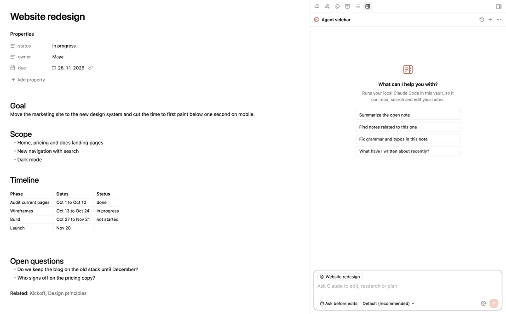
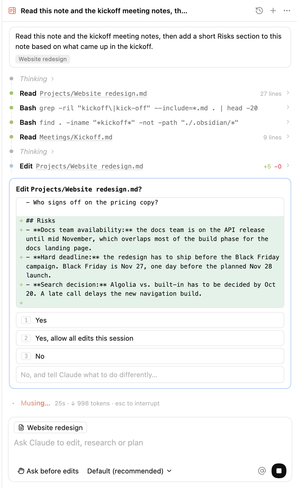
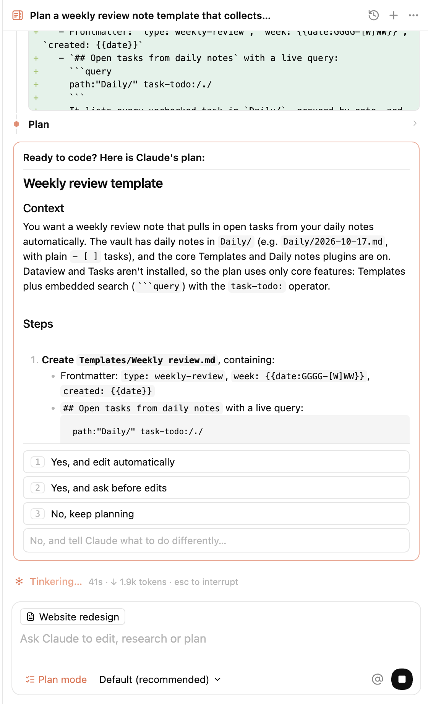
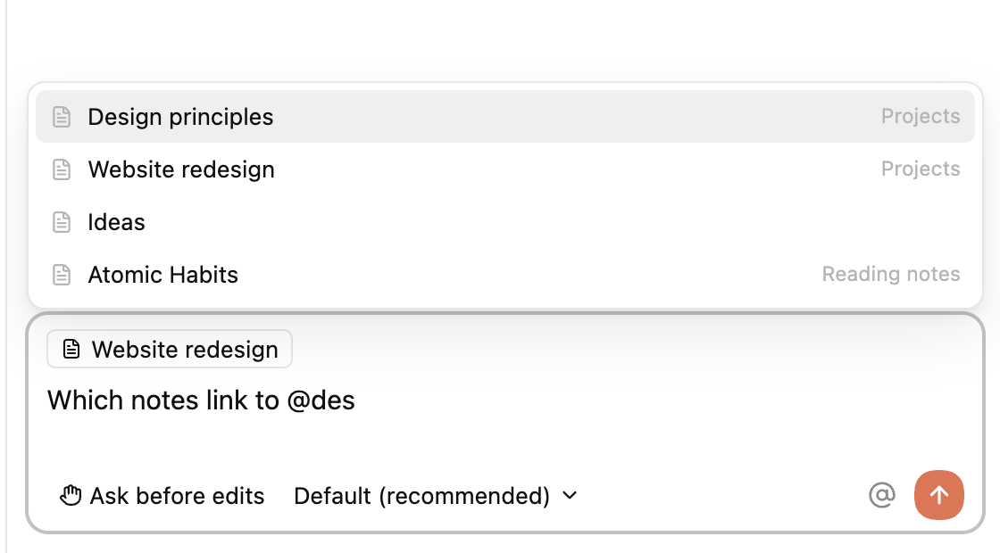

<p align="center">
  
</p>

<h1 align="center">Agent Sidebar</h1>

<p align="center">
  Claude Code in your Obsidian sidebar. It reads, searches and edits your notes, and asks before it changes anything.
</p>

<p align="center">
  <a href="https://github.com/vsaraikin/obsidian-claude-plugin/releases/latest"></a>
  <a href="https://github.com/vsaraikin/obsidian-claude-plugin/releases"></a>
  <a href="https://community.obsidian.md/plugins/agent-sidebar"></a>
  
  <a href="LICENSE"></a>
</p>

<p align="center">
  <a href="#features">Features</a> ·
  <a href="#installation">Installation</a> ·
  <a href="#usage">Usage</a> ·
  <a href="#settings">Settings</a> ·
  <a href="#network-accounts-and-data">Privacy</a>
</p>

<p align="center">
  
</p>

Agent Sidebar runs the `claude` CLI you already have, with your vault as the working directory. The panel is modeled on the Claude Code extension for VS Code: replies stream in, each tool call gets its own row, and edits arrive as diffs you approve.

It is an independent project, not made or endorsed by Anthropic.

## Features

**Readable tool calls.** Every file read, search and shell command is a row with its result one click away. Edits open as a line diff with added and removed counts.

**You approve changes.** Before an edit or a command, Claude asks. Allow it once, allow it for the session, decline, or type what to do instead. Keys 1 to 3 pick an option.

**Permission modes.** Ask before edits, edit automatically, plan mode and auto mode, switched with Shift+Tab. In plan mode you read the plan before a single file changes.

**Your note as context.** Each message tells Claude which note is open and passes the lines you selected. Click the note chip to keep it private.

**Mentions and commands.** `@` finds notes, `/` lists commands, including your own commands and skills. Paste an image to attach it.

**History.** Every Claude Code conversation in the vault is listed, including ones you started in a terminal. Pick one to continue it. The last conversation reopens when Obsidian starts.

<table>
  <tr>
    <td width="50%"></td>
    <td width="50%"></td>
  </tr>
  <tr>
    <td align="center"><sub>Approve an edit after reading the diff</sub></td>
    <td align="center"><sub>Review the plan before Claude edits</sub></td>
  </tr>
  <tr>
    <td width="50%"></td>
    <td width="50%"></td>
  </tr>
  <tr>
    <td align="center"><sub>Mention notes with @</sub></td>
    <td align="center"><sub>Continue any past conversation</sub></td>
  </tr>
</table>

## Requirements

- Obsidian 1.7.2 or later, desktop only. Tested on macOS.
- [Claude Code](https://code.claude.com/docs/en/overview) installed and signed in. If `claude` works in your terminal, the plugin can use it.

## Installation

Agent Sidebar is [listed in the Obsidian community directory](https://community.obsidian.md/plugins/agent-sidebar) and waiting for review. Once it is approved, install it from Settings → Community plugins → Browse. Until then, use BRAT or install it by hand.

**With BRAT.** Install [BRAT](https://github.com/TfTHacker/obsidian42-brat), run "BRAT: Add a beta plugin for testing" and enter `vsaraikin/obsidian-claude-plugin`. BRAT keeps it updated.

**By hand.** Download `main.js`, `manifest.json` and `styles.css` from the [latest release](https://github.com/vsaraikin/obsidian-claude-plugin/releases/latest), put them in `<vault>/.obsidian/plugins/agent-sidebar/`, then enable Agent Sidebar under Settings → Community plugins.

## Usage

Open the panel from the ribbon or with "Agent Sidebar: Open chat". Other commands: New conversation, Resume last conversation, Browse conversation history, Mention current note in the prompt.

| Key | Action |
| --- | --- |
| Enter | Send |
| Shift+Enter | New line |
| Shift+Tab | Next permission mode |
| Esc | Stop Claude |
| ↑ in an empty prompt | Previous message |
| `@` | Mention a note |
| `/` | Commands. `/clear` starts over, `/resume` opens the history |

## Settings

| Setting | What it does |
| --- | --- |
| Claude Code executable | Path to `claude`. Empty means it is looked up on your login shell's PATH. |
| HTTPS proxy | Passed to Claude Code as `HTTPS_PROXY` and `HTTP_PROXY`. Copied from your shell on first run. |
| Default model | Model for new conversations. You can switch it under the prompt. |
| Default permission mode | Mode for new conversations. |
| Share the open note | Send the open note's path and selection with each message. |
| Reopen last conversation | Continue the last conversation when Obsidian starts. |
| Show thinking | Show summarized reasoning as collapsed blocks. |

## How it works

The plugin starts your installed `claude` binary through the [Claude Agent SDK](https://code.claude.com/docs/en/agent-sdk/overview) and keeps one process per conversation, so your CLAUDE.md, settings, skills and MCP servers apply as they do in a terminal. Obsidian started from the Dock does not see your shell configuration, so the plugin reads `PATH` and proxy variables from your login shell once. History comes from the session files in `~/.claude/projects` that `claude --resume` also reads.

## Network, accounts and data

The plugin makes no network requests of its own and has no telemetry. The bundled Claude Agent SDK contains network code, but the plugin only uses the SDK to start and talk to the local `claude` process. The clipboard is read when you paste an image into the prompt and written when you choose "Copy resume command". Claude Code sends your prompts to Anthropic's API, or to the provider you set up in Claude Code. That includes the open note's path, the selected text, and whatever files and command output Claude reads while working.

You need a Claude account or an Anthropic API key, configured in Claude Code. Usage is billed by Anthropic under your own plan, and the plugin never sees your credentials. Anthropic asks third-party tools built on the Agent SDK to use API key authentication; see their [legal and compliance page](https://code.claude.com/docs/en/legal-and-compliance) before using a subscription login here.

Outside the vault, the plugin reads Claude Code's session files in `~/.claude/projects`, checks the usual install folders for the `claude` binary, and runs your login shell once to read `PATH` and proxy variables. It passes your environment to Claude Code so the CLI finds its tools and login. Claude Code itself works in the vault folder, but its tools can reach other paths; it follows your Claude Code permission settings and asks in the panel before edits and most commands.

## Development

```sh
npm install
npm run build                                # type check and bundle into dist/
OBSIDIAN_VAULT="/path/to/vault" npm run dev  # rebuild on change and copy into a vault
npm run test:view                            # render the panel in a simulated DOM
npm run smoke -- /tmp/empty-folder           # one real Claude Code turn, creates hello.md there
```

Releases are built by GitHub Actions when a tag matching the version in `manifest.json` is pushed.

## License

MIT for the plugin's source code. The released `main.js` also contains the Claude Agent SDK, which belongs to Anthropic PBC and is covered by Anthropic's terms.
